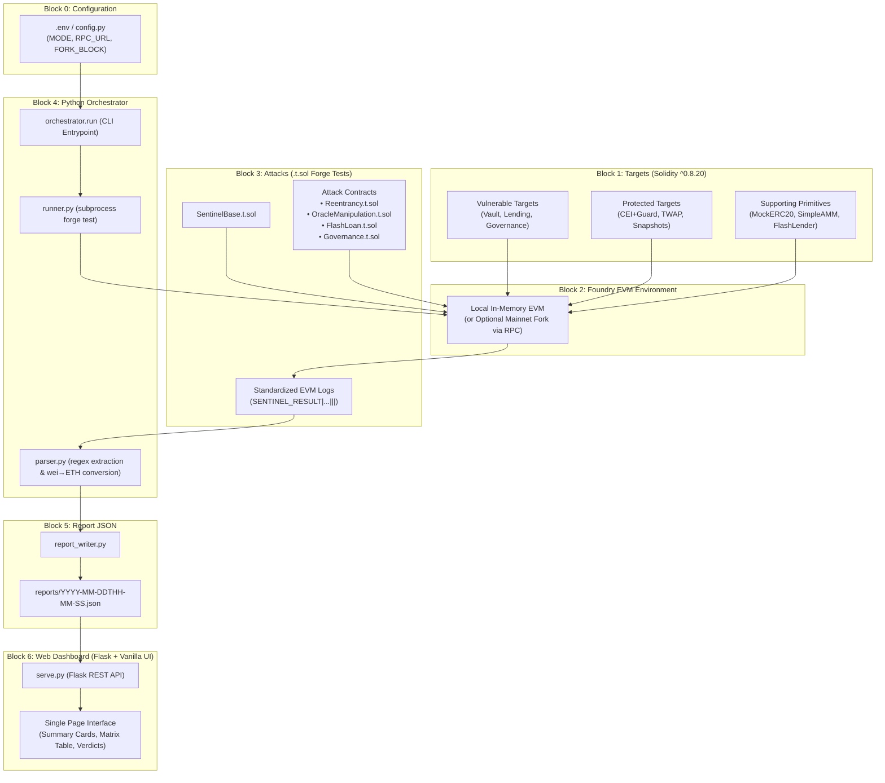

# DeFiSentinel System Architecture

DeFiSentinel is an end-to-end security simulation framework designed to execute, verify, and visualize known decentralized finance (DeFi) exploits and defenses on local EVM instances using zero mocked results.

---

## 1. Six-Block Architectural Pipeline

The system is organized into a clean 6-block unidirectional pipeline:



---

## 2. Block Responsibilities & Separation of Concerns

| Block | Component | Responsibility | Technology |
|---|---|---|---|
| **Block 0** | Configuration | Environment variables (`MODE=local` or `fork`, optional `RPC_URL` and `FORK_BLOCK`). | Python `dotenv`, `config.py` |
| **Block 1** | Target Contracts | Realistic toy DeFi protocols written in Solidity. Each exists in a **Vulnerable** (containing an exploitable flaw) and **Protected** (mitigated) variant. | Solidity `^0.8.20` |
| **Block 2** | Local / Fork EVM | High-speed, reproducible EVM execution sandbox. Handled natively by Foundry without third-party RPC dependencies by default. | Foundry `forge` |
| **Block 3** | Attack Harnesses | Attack simulation suites inheriting `SentinelBase.t.sol`. Executes atomic multi-step exploits, wraps them in `try/catch` to isolate reverts, and logs verdicts. | Foundry Forge Tests (`.t.sol`) |
| **Block 4** | Orchestrator | Spawns subprocesses running `forge test`, enforces timeouts, and parses stdout text with strict regular expressions. | Python 3, `subprocess`, `re` |
| **Block 5** | Report Storage | Persists execution metrics into immutable, timestamped JSON reports adhering to a frozen schema. | Python, JSON filesystem |
| **Block 6** | Dashboard | Reads JSON reports from disk and renders a vulnerable-vs-protected comparison with plain-language verdicts. Starts new runs only via the orchestrator's scan manager (`POST /api/scans`), never by invoking Foundry itself. | Flask, HTML5, Vanilla CSS/JS |

---

## 3. Data Flow & Execution Sequence

1. **Invocation**: The user triggers `python -m orchestrator.run --modules all --variant both`.
2. **Subprocess Dispatch**: `runner.py` builds the CLI call:
   ```bash
   forge test --match-path contracts/attacks/<Module>.t.sol -vv
   ```
   with environment variable `VARIANT=vulnerable` or `VARIANT=protected`.
3. **EVM Execution**: Foundry compiles contracts and executes the test:
   - Target contracts deploy into the ephemeral EVM state.
   - Seed liquidity is supplied by honest actors.
   - Attacker initiates the multi-step exploit contract.
   - For **Vulnerable** variants, the exploit drains pool/vault funds into the attacker wallet.
   - For **Protected** variants, protocols revert upon detecting manipulation (e.g., non-reentrant locks, TWAP deviation bounds, snapshot checks). The attack test catches the revert and records zero profit.
4. **Log Emission**: The Solidity test logs a single structured stdout line:
   ```text
   SENTINEL_RESULT|<module>|<variant>|<SUCCEEDED|FAILED>|<profit_wei>|<note>
   ```
5. **Parsing**: `parser.py` captures stdout, matches the strict regex, and converts `profit_wei` to `profit_eth` (`wei / 1e18`).
6. **Persistence**: `report_writer.py` aggregates all module results into `reports/<timestamp>.json`.
7. **Visualization**: Flask reads the report on request (`/api/reports/<id>`) and the web client displays the security verdict.

---

## 4. Dashboard-Initiated Scans

The web UI can also trigger a run:

1. `POST /api/scans` validates the request and asks `orchestrator.scan_manager` to start a background job (one at a time; `409` if busy).
2. The job runs `forge build` once, then each module/variant through `orchestrator.engine.run_single` (the same code path as the CLI).
3. `GET /api/scans/<id>` returns live per-module progress; the UI polls it.
4. On success the job writes a normal report via `report_writer`, and the UI loads it from `/api/reports/<report_id>`. Cancelled or failed scans write no report.

RPC URL and fork block come only from the server `.env`, never from the request.
